# 🚗 Licence-Plate_Detection-YOLOv8: Automatic License Plate Recognition & OCR Comparison

An advanced, high-performance Automatic License Plate Recognition (ALPR) system. This repository contains the code, dataset configuration, notebook demonstrations, and comparative performance analysis detailed in our research paper. It showcases two distinct deep learning architectures for license plate localization and character recognition:
1. **YOLOv8 Detection + Multi-Engine OCR Comparison** (PaddleOCR vs. EasyOCR vs. Tesseract)
2. **Custom Convolutional Neural Network (CNN)** trained from scratch for character segmentation and classification.

---

## 📜 Publication Citation

*   **Paper Title**: *License Plate Detection using YOLO v8 and Performance Evaluation of EasyOCR, PaddleOCR and Tesseract*
*   **Authors**: P Praneeth Reddy, P Sai Shruthi, P Himanshu, Tripty Singh
*   **Affiliation**: Dept. of Computer Science and Engineering, Amrita School of Computing, Bengaluru, Amrita Vishwa Vidyapeetham, India
*   **Paper Copy**: [Download PDF](publication/License_Plate_Detection_Using_YOLOv8.pdf)

---

## 📂 Repository Structure

*   [`YOLOv8_License_Plate_Detection_and_OCR_Evaluation.ipynb`](YOLOv8_License_Plate_Detection_and_OCR_Evaluation.ipynb): Jupyter notebook showcasing license plate localization via YOLOv8 (trained for 100 epochs) and a comparative statistical evaluation of EasyOCR, PaddleOCR, and Tesseract.
*   [`Custom_CNN_License_Plate_Segmentation_and_Recognition.ipynb`](Custom_CNN_License_Plate_Segmentation_and_Recognition.ipynb): Jupyter notebook detailing character segmentation via morphological filtering and character classification using a custom Convolutional Neural Network (CNN) built from scratch using Keras/TensorFlow.
*   [`images/`](images/): Directory containing visual assets, intermediate pipeline outputs, and OCR performance analysis charts.
*   [`publication/`](publication/): Folder housing the PDF version of the research paper.

---

## 📐 System Architecture

The pipeline processes input vehicle images through localization, cropping, character segmentation, and optical character recognition:

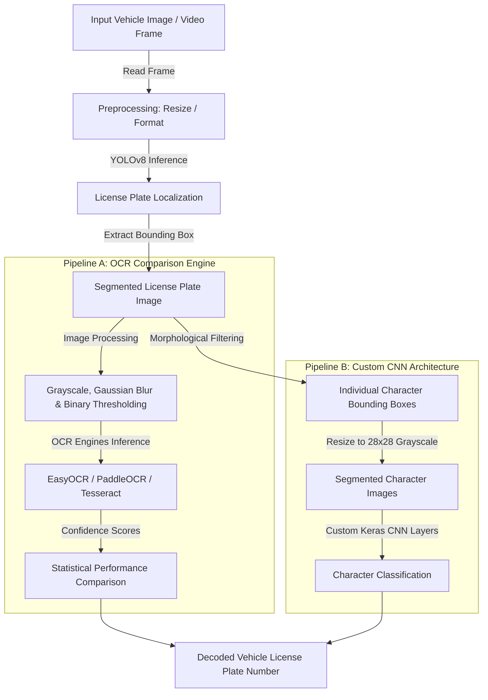

---

## ⚙️ Detailed Methodology & Pipeline Explanations

### Pipeline A: YOLOv8 & Multi-Engine OCR Comparison

#### 1. License Plate Localization via YOLOv8
The object detection model is trained on the open-source **Roboflow Indian License Plate Dataset** (containing approximately 1,100 annotated vehicle images). The YOLOv8 model was trained for **100 epochs** with a batch size of **16** using the Adam optimizer. The learning rate is managed via a scheduler decreasing from `0.070286` in the initial epoch to `0.002575` in the final epoch to ensure smooth convergence.

Once the bounding box coordinates `[x, y, w, h]` are retrieved, the cropped plate image undergoes image preprocessing, including conversion to grayscale, Gaussian noise filtering, and Otsu's binary thresholding to prepare the character outlines for extraction:

  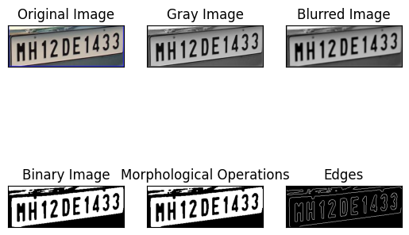

  <em>Figure 1: Grayscale conversion, noise reduction with Gaussian blur, and Otsu's thresholding applied to the cropped plate.</em>

---

#### 2. Multi-Engine OCR Comparison Setup
After preprocessing, three major OCR engines are executed to identify characters and record their output confidence levels:
*   **PaddleOCR (Baidu)**: Built on PaddlePaddle, optimized for speed and multilingual capabilities.
*   **EasyOCR (Jaided AI)**: Built on PyTorch, using ResNet and LSTM backbones.
*   **Tesseract OCR (Google)**: A traditional OCR engine combining line finding, layout analysis, and adaptive classification.

To evaluate these models, we tracked their confidence scores across 42 distinct license plate test images:

  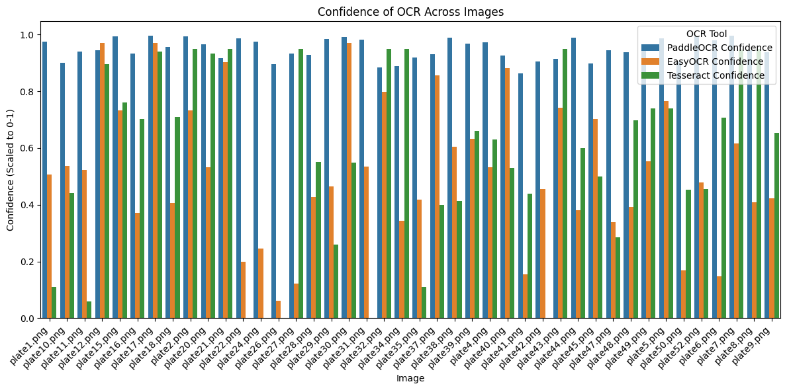

  <em>Figure 2: Raw confidence levels recorded by PaddleOCR, EasyOCR, and Tesseract across 42 test images.</em>

---

#### 3. Statistical Analysis of OCR Performance
A boxplot analysis reveals the distribution characteristics of the three models. **PaddleOCR** shows a median confidence score close to **1.0** with extremely low variability, demonstrating high reliability. **EasyOCR** shows the widest range of confidence scores with a lower median around **0.5**, suggesting a higher rate of fluctuating quality. **Tesseract** falls in the middle, displaying a median confidence of around **0.7**:

  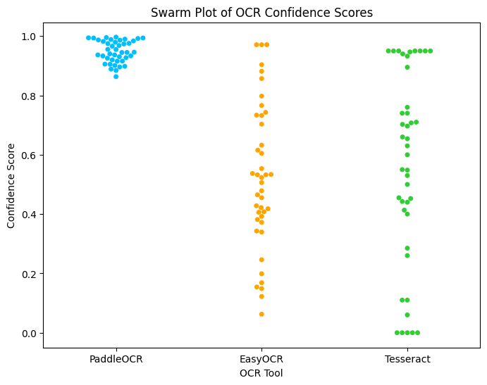

  <em>Figure 3: Boxplot showing the median, quartiles, range, and outliers of confidence scores for the three OCR systems.</em>

---

#### 4. OCR Confidence Distribution Analysis
Examining the probability density histograms gives a deeper look into the engines' performances:
*   **PaddleOCR**: Most confidence scores are clustered tightly between `0.9` and `1.0`. It successfully resolves common digit/character confusions (like `0/O`, `5/S`, `I/1`, and `2/Z`).
*   **EasyOCR**: Follows a bimodal distribution with distinct peaks at `0.4` and `0.8`, indicating high variability.
*   **Tesseract**: Shows a highly dispersed spread, with confidence peaking near `0.8` but with substantial density extending down to lower scores.

  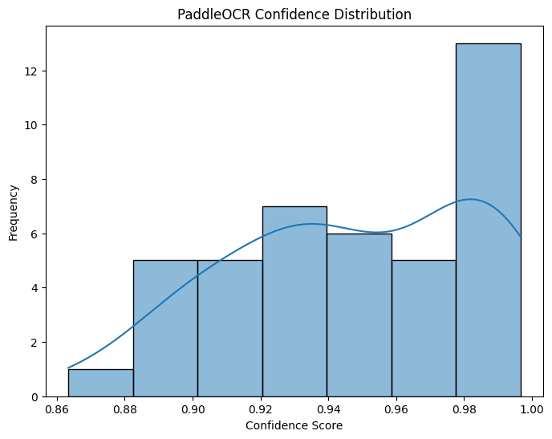

  <em>Figure 4: PaddleOCR confidence scores tightly clustered towards the higher end (0.9 to 1.0).</em>

  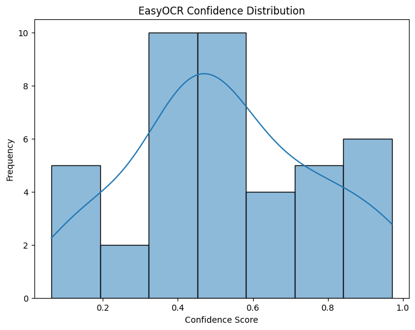

  <em>Figure 5: Bimodal distribution of EasyOCR confidence scores, highlighting its performance variability.</em>

  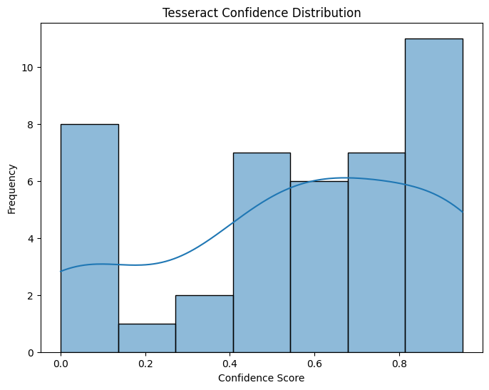

  <em>Figure 6: Highly dispersed confidence score distribution for the Tesseract OCR engine.</em>

---

### Pipeline B: Custom CNN Architecture

As an alternative to utilizing general-purpose OCR engines, we implement a custom Convolutional Neural Network (CNN) built and trained from scratch using Keras/TensorFlow.

#### 1. Input and Localization
The process starts by retrieving the raw input vehicle image and passing it to the localization network to identify the bounding box of the license plate:

  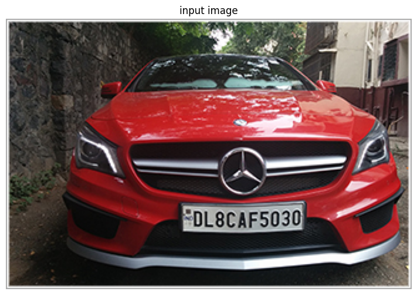

  <em>Figure 7: Original input image loaded into the custom CNN recognition pipeline.</em>

  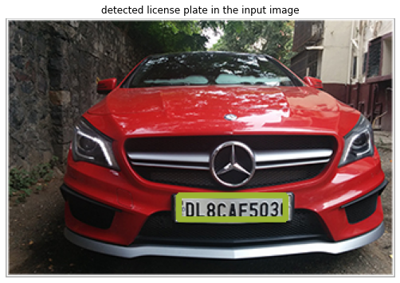

  <em>Figure 8: Localization bounding box identifying the coordinates of the license plate on the vehicle.</em>

---

#### 2. License Plate Extraction and Character Segmentation
The plate is cropped from the original image based on the detected coordinates. We then apply morphological edge filtering (e.g. contour detection and thresholding) to segment the individual character blocks. Each character is extracted, converted to grayscale, and resized to a standard `28x28` matrix:

  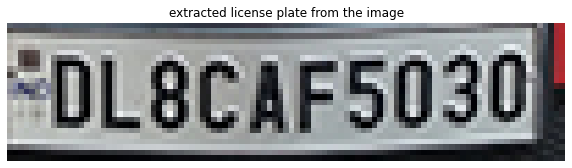

  <em>Figure 9: The cropped license plate region isolated for character segmentation.</em>

  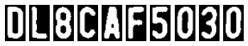

  <em>Figure 10: Extracted character blocks resized to 28x28 grayscale matrices.</em>

---

#### 3. CNN Classification & Overlay Presentation
The `28x28` inputs are fed into the custom CNN classifier, which consists of two `Conv2D` layers (with `ReLU` activations), `MaxPooling2D` layers, `Dropout` layers, and a final `Dense` layer with a `softmax` activation yielding probabilities for 36 classes (0-9, A-Z). 

The classification results are matched to their corresponding bounding boxes and overlaid back onto the original vehicle image for visualization:

  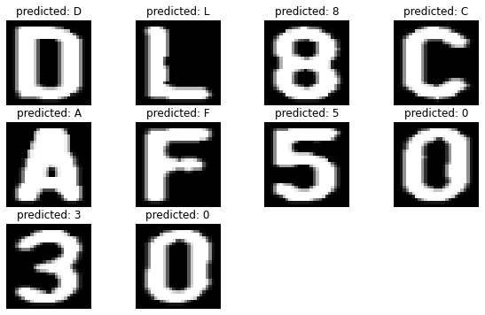

  <em>Figure 11: Predictions output by the custom CNN classifier for each segmented letter and digit.</em>

  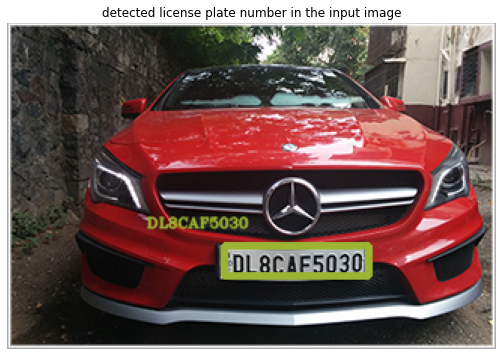

  <em>Figure 12: Final system output with recognized text overlaid on top of the vehicle image.</em>

